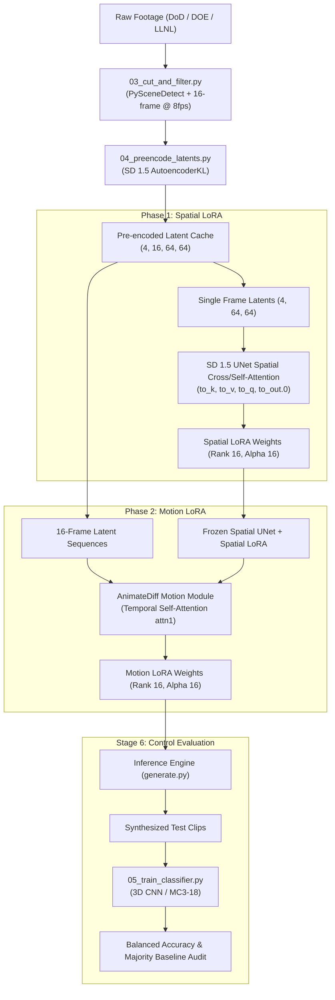

# Operation Archival: Parameter-Controlled Archival Nuclear Test Video Generator (1945–1962)

[](LICENSE)
[](https://www.python.org/)
[](https://pytorch.org/)
[](https://huggingface.co/docs/diffusers)

An end-to-end deep learning engineering pipeline for synthesizing parameter-conditioned archival video clips of historical atmospheric nuclear detonations (1945–1962). The generator is conditioned on burst geometry, yield tier, geographic setting, detonation phase, and historical 16mm film stock.

---

## 💥 Architecture: Two-Phase Decoupled LoRA

A core technical challenge in motion-module fine-tuning is that **conditioning signals enter through spatial cross-attention layers**, which standard temporal-only training freezes. Changes such as *underwater vs. surface-tower*, *Nevada desert vs. Pacific lagoon*, or *B&W vs. Technicolor* are predominantly spatial visual changes.

To solve this, we implement a **two-phase decoupled LoRA adaptation pipeline**:



1. **Phase 1 (Spatial LoRA):** Fine-tunes SD 1.5 UNet spatial self/cross-attention projections on static frames. This grounds visual appearance, cloud morphology, terrain, and 16mm film grain.
2. **Phase 2 (Motion LoRA):** Freezes the spatial UNet with the Spatial LoRA active, and trains the temporal *self-attention* layers in the AnimateDiff motion module on 16-frame latent sequences (`4, 16, 64, 64`) to learn fluid explosion dynamics.

---

## 🎛️ Conditioned Parameter Schema

Every clip is controlled along canonical decoupled axes defined in [`schema.py`](schema.py):

| Parameter | Permitted Categories | Physical / Historical Significance |
|---|---|---|
| **Burst Type** | `air-burst`, `surface-tower`, `surface-barge`, `underwater` | Determines ground soil entrainment, stem thickness, or water column & base surge. |
| **Yield Tier** | `sub-kiloton` (<1 kt), `tactical-yield` (1–20 kt), `intermediate-yield` (20 kt–1 Mt), `megaton-class` (≥1 Mt) | Four non-overlapping tiers governing cloud scale, fireball radius, and thermal energy. |
| **Terrain** | `desert-flats`, `tropical-ocean` | Nevada Test Site (Yucca / Frenchman Flat) vs. Pacific Proving Grounds (Bikini / Enewetak). |
| **Lighting** | `day`, `night`, `dawn` | Solar lighting condition computed from historical detonation timestamps and coordinates. |
| **Phase** | `early-fireball`, `expansion`, `stabilized-cloud` | Physical evolution phase based on time elapsed since detonation flash onset. |
| **Film Look** | `black-and-white`, `faded-technicolor`, `colour-restored` | Historical 16mm stock, Technicolor dye-fading, or LLNL digital restoration. |
| **Diagnostics** | `with smoke-trails`, `without smoke-trails` | Sounding rocket tracer smoke lines used to track shockwave propagation. |

---

## 📊 Ground Truth & Data Governance

- **Official Ground Truth:** Extracted directly from official Department of Energy report **DOE/NV-209 Rev 16** (*United States Nuclear Tests, July 1945 through September 1992*).
- **211-Detonation Training Corpus:** Captures 206 US atmospheric tests and 5 underwater tests from DOE/NV-209 Rev 16. The official 216 pre-LTBT tally also includes 5 shallow crater events; these are tracked in the registry but excluded from the 4-class burst schema because they are not air-burst, tower, barge, or underwater footage. The 4 Joint US-UK Roller Coaster events are excluded entirely because they were high-explosive plutonium-dispersal safety tests, not nuclear detonations. See [`docs/RECONCILIATION_216.md`](docs/RECONCILIATION_216.md).
- **Audit Findings:** See [`docs/DOE_NV209_AUDIT.md`](docs/DOE_NV209_AUDIT.md).
- **Stratified Grouping:** The 5 historical underwater shots (*Baker*, *Wigwam*, *Wahoo*, *Umbrella*, *Swordfish*) are split deterministically across train (3), validation (1), and test (1) splits to prevent evaluation collapse.
- **Physical Confounding:** 100% of underwater and megaton-class shots were conducted in the Pacific Proving Grounds; our evaluation explicitly accounts for this historical entanglement.
- **Demo Footage Truth-up:** In accordance with non-negotiable project governance, sample footage currently displayed in `web/videos/` and `samples/` represents archival demo reference footage for interface testing until full two-phase model weights are trained on remote GPU hardware.

---

## 🚀 Quickstart & Reproduction

### 1. Installation
```bash
git clone https://github.com/v1has/Nuclear-Test-Video-Generator.git
cd Nuclear-Test-Video-Generator
pip install -r requirements.txt
```

### 2. Video Preprocessing & Latent Pre-Encoding
```bash
# 1. Segment raw archival reels into standardized 16-frame clips at 8 fps:
python scripts/03_cut_and_filter.py

# 2. Pre-encode video clips into SD 1.5 latent tensors (4, 16, 64, 64):
python scripts/04_preencode_latents.py --all --assert-100
```

### 3. Training on Kaggle (2× T4 GPUs)
Use the self-contained Kaggle pipeline notebook [`training/kaggle_train_pipeline.ipynb`](training/kaggle_train_pipeline.ipynb):
- Pre-encodes latents with chunked micro-batches.
- Executes Phase 1 Spatial LoRA training (2,000 steps).
- Executes Phase 2 Motion LoRA training (3,000 steps).
- Checkpoints automatically every 250 steps to `/kaggle/working/`.

### 4. CLI Inference
```bash
python inference/generate.py \
  --burst_type underwater \
  --yield_tier tactical-yield \
  --setting tropical-ocean \
  --phase expansion \
  --film_look colour-restored \
  --output samples/underwater_expansion.mp4
```

### 5. Interactive Web Console (GitHub Pages)
Launch the interactive web showcase:
```bash
python -m http.server 8080 --directory web
```
Open `http://localhost:8080` to explore:
- **Interactive Synthesizer:** Real-time parameter switching with telecine CRT playback, frame-by-frame controls, and telemetry readouts.
- **Disentanglement Matrix:** Side-by-side comparison sweeping single variables while holding other factors constant.
- **DOE Historical Archive:** Searchable database of 211 training-eligible detonations (206 US atmospheric + 5 underwater) plus 5 audited crater events and 4 excluded Roller Coaster safety tests from DOE/NV-209 Rev 16.

---

## 📈 Evaluation & Control Accuracy

Stage 6 implements a multi-task 3D CNN classifier (`scripts/05_train_classifier.py` based on `mc3_18` / `resnet18_avgpool`) trained on real footage to predict `burst_type` (4-class), `yield_tier` (4-class), and `phase` (3-class).

Synthetic videos must pass the **Validation Gate**:
$$\text{Balanced Accuracy} \ge \text{Majority-Class Baseline} + 25\%$$

Audit reports are automatically saved to `data/synthetic_control_report.json`.

---

## 📜 License & Citation

This codebase is licensed under the [MIT License](LICENSE). All historical video footage is sourced from official US Government agencies (US Department of Energy, National Nuclear Security Administration, Lawrence Livermore National Laboratory, and US National Archives) and is in the public domain under **17 U.S.C. § 105**.

For an exhaustive legal analysis reconciling historical footage provenance against third-party platform licensing tags (e.g. Internet Archive CC BY-NC-ND uploads), see [`docs/LICENSING_RECONCILIATION.md`](docs/LICENSING_RECONCILIATION.md).