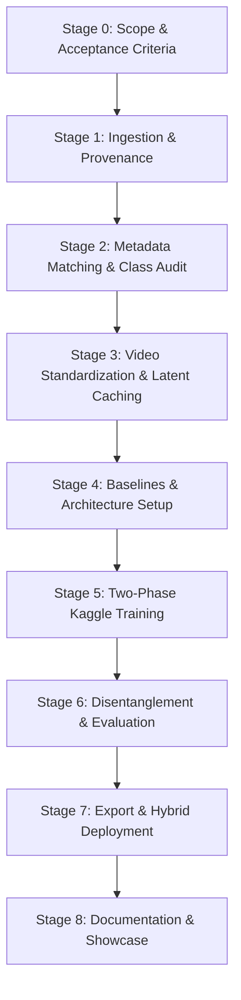

# Project Plan: Parameter-Controlled Archival Nuclear Test Video Generator

**Goal:** Generate short, historically styled video clips of atmospheric nuclear tests, conditioned on burst type, yield tier, lighting/setting, phase, and film look. The model is trained on Kaggle and showcased on GitHub with an interactive web demonstration.

---

## 1. Executive Summary & Core Strategy

This project builds an educational, historical-visualization pipeline for generating synthetic archival clips of historical atmospheric nuclear detonations (1945–1962). Rather than attempting to train a video generation model from scratch, this project fine-tunes Stable Diffusion 1.5 using a **two-phase LoRA adaptation strategy**:

1. **Phase 1 — Spatial LoRA (Appearance & Conditioning):** Text conditioning in latent diffusion models enters via the spatial cross-attention layers of the 2D UNet. Because parameters like burst type (underwater vs. tower), setting (desert vs. ocean), lighting (day vs. night), and film look (B&W vs. colour) are fundamentally appearance-based, a temporal-only motion module cannot learn these visual distinctions if spatial layers remain frozen with base weights. We first train a Spatial LoRA on static frames extracted from the test footage to teach the model nuclear explosion textures, fireball geometry, and parameter associations.
2. **Phase 2 — Motion LoRA (Temporal Dynamics):** Once the spatial base is conditioned, we freeze the spatial weights and train an **AnimateDiff Motion LoRA** across the temporal *self-attention* layers to learn the physics of fluid expansion, shockwave propagation, and cloud rise.

### Architecture Comparison & Contingency

| Strategy | Base Model | Target Resolution & Length | Strengths | Trade-offs & Contingency |
|---|---|---|---|---|
| **Primary (Diffusion)** | SD 1.5 + Spatial LoRA + AnimateDiff Motion LoRA | 384×384 or 512×512, 16 frames @ 8 fps | Leverages rich visual priors; photorealistic archival texture, lighting, and hydrodynamic motion | Requires two-phase training (spatial then temporal) and disciplined latent caching |
| **Fallback (GAN)** | DIGAN (Dynamics-aware Implicit GAN) | 128×128, 16 frames | Trainable from scratch on small datasets (hundreds of samples); low compute requirement | Lower visual fidelity; prone to blurriness, mode collapse, and weak prompt adherence |

---

## 2. Key Corrections & Engineering Decisions

To ensure empirical validity, avoid common diffusion pitfalls, and operate within Kaggle constraints, the following rules govern this implementation:

1. **Conditioning Architecture (Two-Phase LoRA):** Text prompt conditioning enters through spatial cross-attention, while AnimateDiff temporal layers use temporal *self-attention*. Appearance parameters cannot be conditioned through temporal layers alone. We train a Spatial LoRA first, followed by a Motion LoRA.
2. **Standardized, Tokenizer-Friendly Yield Tiers:** Numerical ranges like `"20 kt to 1 Mt"` tokenize poorly in CLIP. We map yields into four clean, descriptive categorical tokens:
   - `sub-kiloton` (<1 kt: rapid fireball cooling, tactical scale)
   - `tactical-yield` (1–20 kt: classic mushroom cloud with toroidal vortex and distinct stem)
   - `intermediate-yield` (20 kt–1 Mt: massive stem, dark shock dirt skirt, stratospheric reach)
   - `megaton-class` (>1 Mt: giant multi-kilometer fireball, immense anvil spread)
3. **Class Count Audit & Grouped Splitting:** Footage is sparse for rare categories (e.g., underwater tests like *Baker*, *Wahoo*, *Umbrella*, *Wigwam*). A naive random split would leave zero validation/test samples for rare classes. We implement an explicit class-count audit in Stage 2 to gate dataset readiness and use grouped/stratified shot splits.
4. **Confounding Acknowledgment:** Burst type and geographic setting are historically confounded (e.g., underwater tests occurred almost exclusively in Pacific atolls). Evaluation protocols must account for this entanglement rather than assuming independent factor perturbation.
5. **Native Resolution Alignment:** SD 1.5 was trained natively at 512×512. Downscaling to 256×256 severely degrades spatial detail and produces artifacts. We test 384×384 and 512×512 during Stage 4 baselines.
6. **Augmentation and Latent Caching Alignment:** Augmentations (horizontal flips, temporal stride jitter) cannot be applied to pre-encoded latent tensors on the fly. All augmentations must be generated during video extraction and pre-encoded as distinct cached latent files.
7. **Accurate Efficiency Expectations:** Latent caching reduces per-step compute overhead and VRAM by avoiding redundant VAE forward passes, but does not alter UNet backward pass costs. Exact benchmarks will be measured during the Stage 4 dry run.
8. **Realistic Licensing Assessment (Risk = Medium):** While U.S. Federal Government works are public domain (17 U.S.C. § 105), historical footage involves contractor productions (e.g., EG&G, Lookout Mountain Laboratory) and mixed-rights archive uploads. Each item must have an explicit provenance entry in `sources.csv`.
9. **Realistic Timeline:** 45 days represents full-time execution (~6–7 weeks). For part-time pacing, budget 10–12 weeks.
10. **Web Showcase Default:** Free Hugging Face ZeroGPU typically requires a PRO subscription or faces strict quota limits. The default guaranteed web deployment is a responsive static parameter-matrix viewer on GitHub Pages, with HF Space API integration as an opt-in live enhancement.

---

## 3. Conditioning Schema

### Final Locked Parameter Matrix

| Parameter | Prompt Token / Value | Historical & Physical Grounding |
|---|---|---|
| **Burst Type** | `underwater`, `surface-tower`, `air-burst` | Water column, condensation dome, base surge mist vs. heavy dirt stem, ground suction, dark shock ring vs. clean spherical fireball, minimal ground dirt |
| **Yield Tier** | `sub-kiloton`, `tactical-yield`, `intermediate-yield`, `megaton-class` | Governed by Taylor-Sedov scaling ($R \propto (E/\rho)^{1/5} t^{2/5}$); determines fireball expansion speed, cloud ceiling, and anvil width |
| **Setting / Lighting** | `desert-day`, `desert-night`, `tropical-ocean`, `tropical-dawn` | Desert dust skirt, blue sky vs. stark silhouette horizon, high-contrast flash vs. turquoise lagoon reflections, cumulus clouds vs. early morning twilight |
| **Detonation Phase** | `flash-fireball`, `stem-rise`, `stabilized-cloud` | Early milliseconds–1s luminous growth & Mach stem vs. seconds 2–5 toroidal vortex & debris updraft vs. seconds 5+ dissipation, ice cap, anvil spread |
| **Film Look** | `black-and-white`, `colour-restored` | 16mm/35mm archival film grain, optical light leaks vs. Technicolor/Kodachrome saturated skies and orange fireball hues (dictated by available data balance) |
| **Diagnostic Smoke Trails** | `with smoke-trails`, `without smoke-trails` | Vertical white sounding-rocket trails fired seconds before blast to measure shockwave refractive velocity (optional toggle) |

### Prompt Template

Conditioning parameters are mapped into a standardized prompt template:
```text
"{burst_type} nuclear detonation, {yield_tier}, {setting}, {phase} phase, {film_look} archival footage, {smoke_trails}"
```
*Example:* `"underwater nuclear detonation, intermediate-yield, tropical-ocean, stabilized-cloud phase, black-and-white archival footage, without smoke-trails"`

---

## 4. Legal, Ethical, & Hosting Considerations

1. **Public Domain Verification (17 U.S.C. § 105):** Official U.S. Federal Government works created by military or civil personnel are in the public domain. However, because contractors (e.g., EG&G) and third-party documentary distributors contributed to surviving archives, rights must be tracked per clip in `sources.csv`. Any source with unclear provenance is excluded.
2. **Platform Terms of Service Compliance:**
   - In accordance with YouTube Terms of Service (Section 5), automated bulk video scraping via tools like `yt-dlp` is avoided.
   - For LLNL archival footage hosted on YouTube, metadata is retrieved via the official YouTube Data API v3, and video inspection is conducted locally for research purposes.
   - Primary bulk downloads are sourced from open repositories: **Internet Archive** (`internetarchive` SDK), National Archives and Records Administration (NARA), and Wikimedia Commons.
3. **Repository Storage Discipline:**
   - No video binaries, latent tensors, or large model weights may be committed to Git.
   - Datasets and latent archives are versioned on Hugging Face Datasets or Kaggle Datasets.
   - Spatial and Motion LoRA weights are published to Hugging Face Model Hub.
4. **Educational Context:**
   - The repository documentation and web UI clearly state that the project is an educational, physics-grounded historical visualization of declassified Cold War testing.

---

## 5. Development Stages (45-Day Full-Time Plan)



### Stage 0: Scope and Success Criteria (Days 1–2)
- Lock the conditioning schema and prompt tokenization.
- Define quantitative acceptance criteria:
  1. **Visual Stability:** 16-frame clips at 8 fps (2.0s) show continuous temporal motion without flickering or geometric collapse.
  2. **Disentangled Conditioning:** Modifying individual prompt tokens visibly alters the corresponding visual feature.
  3. **Control Accuracy:** A trained video classifier achieves a balanced accuracy score at least **25% above the majority-class baseline** across identifiable categories (`burst_type`, `setting`, `film_look`).
- Initialize repository structure and development environment.

### Stage 1: Data Acquisition (Days 3–7)
- Programmatic acquisition using the `internetarchive` Python library targeting AEC/DoD film collections (Operations Crossroads, Upshot-Knothole, Buster-Jangle, Teapot, Plumbbob, Hardtack I/II).
- Curate public domain clips from NARA and Wikimedia Commons.
- For LLNL archival footage, record official catalog IDs and verify video quality.
- **Validation Gate:** Acquire footage covering at least **30 distinct, verified nuclear test shots**.
- Output: `raw_videos/` directory (external to Git) and `sources.csv` recording URL, title, archive ID, contractor/agency attribution, license note, and access date.

### Stage 2: Labelling, Manifest, & Class-Count Audit (Days 7–12)
- Parse official ground truth from **DOE/NV-209** (*United States Nuclear Tests, July 1945 through September 1992*):
  - Shot name, operation, date, time (UTC and local), test site (NTS vs. PPG), burst altitude/type, and official yield.
- Match footage to DOE records using shot names in titles and manual cross-referencing.
- **Class-Count Audit (Critical Gate):**
  - Run `02b_audit_class_counts.py` to tabulate total shots per parameter combination.
  - Rare shot rule: If any class has fewer than 8–10 independent shots (notably `underwater`), implement stratified grouping to ensure the validation and test sets each contain representative samples, or merge under-represented sub-classes.
- Assign train/val/test splits strictly at the **shot level** (~80% train, ~10% val, ~10% test) to prevent data leakage between duplicate camera angles of the same explosion.
- Output: `manifest.csv` (`clip_id, shot_name, source_video, start_time, end_time, burst, yield_tier, setting, phase, film, split`).

### Stage 3: Standardization, Augmentation, & Latent Pre-encoding (Days 12–16)
- **Segmentation:** Use `ffmpeg` and PySceneDetect (`scenedetect`) to split footage into uniform 16-frame sequences at 8 fps (~2 seconds).
- **Artifact Removal:** Automatically discard title cards, countdown slates, overexposed white flash frames (>95% saturation), blank frames, and burned-in text.
- **Resolution & Sizing:** Standardize to 512×512 (with 384×384 as a memory-optimized alternative) via center-cropping and bicubic resampling.
- **Augmentation Pipeline:**
  - Apply horizontal flips and temporal stride jitter ($\pm 1$ frame stride) during the video extraction phase.
  - Every augmented variant is saved as a discrete sample with a corresponding manifest record before encoding.
- **VAE Pre-encoding:**
  - Pre-encode all video sequences into latent tensors ($4 \times 16 \times 64 \times 64$ for 512×512, or $4 \times 16 \times 48 \times 48$ for 384×384) using Stable Diffusion 1.5's `AutoencoderKL`.
  - Save tensors as `.pt` or `.npy` files. Caching eliminates per-epoch VAE forward passes during UNet training.
- **Validation Gate:** Minimum 1,000 clean, pre-encoded latent sequences indexed in `manifest.csv`.

### Stage 4: Baselines and Model Design (Days 16–20)
- **Baseline Generation:** Run pre-trained Stable Diffusion 1.5 + base AnimateDiff with the standardized prompts without fine-tuning to record the unadapted baseline for evaluation comparisons.
- **Two-Phase Architecture Formulation:**
  - **Phase 1 Configuration:** Spatial LoRA (rank 16–32, $\alpha=16$) targeting SD 1.5 UNet cross-attention (`to_k`, `to_v`, `to_q`) and self-attention projections.
  - **Phase 2 Configuration:** AnimateDiff Motion LoRA (rank 16–32) targeting temporal *self-attention* layers in the motion module.
- **Resolution Testing:** Conduct comparative test runs at 384×384 vs. 512×512 to establish VRAM footprint, throughput, and visual sharpness on target Kaggle GPU hardware.
- **Dry Run Validation:** Execute 100 training steps on 20 clips to verify gradient stability, optimizer states, and checkpoint integrity before launching production runs.

### Stage 5: Two-Phase Training on Kaggle (Days 20–30)
- **Compute Environment:** Kaggle Notebook with 2× NVIDIA T4 (16 GB each) or 1× NVIDIA P100 (16 GB).
- **Optimization Stack:** PyTorch 2.x SDPA (`torch.nn.functional.scaled_dot_product_attention`) or `xformers`, FP16 mixed precision, gradient checkpointing, micro-batch size 1–2 with gradient accumulation.
- **Training Workflow:**
  1. **Phase 1 (Spatial LoRA):** Train on static frames extracted from the training split (approx. 1,500–2,000 steps, learning rate $1\text{e-}4$). This teaches the model specific burst geometry, cloud texture, and historical film grain.
  2. **Phase 2 (Motion LoRA):** Freeze the spatial UNet weights with the trained Spatial LoRA merged or active, then train the temporal self-attention layers on 16-frame latent sequences (approx. 2,500–3,500 steps, learning rate $3\text{e-}5$ to $5\text{e-}5$ with cosine decay).
- **Session Discipline:** Save checkpoints every 250 steps to `/kaggle/working/`, logging full optimizer, scheduler, and RNG state to ensure seamless resumption across Kaggle's 12-hour session limits.
- **Telemetry:** Real-time metrics via TensorBoard / Weights & Biases with fixed-seed evaluation prompts generated every 250 steps.

### Stage 6: Evaluation & Disentanglement Analysis (Days 30–34)
- **Disentanglement Grids:** Fix the seed and prompt parameters while sweeping a single variable (e.g., hold setting and phase constant while toggling `burst_type` across `surface-tower`, `air-burst`, and `underwater`).
- **Addressing Physical Confounding:** Explicitly note in evaluation reports where parameters are historically entangled (e.g., `underwater` tests were conducted exclusively in Pacific lagoons, so ocean background and water column dynamics cannot be fully uncoupled).
- **Quantitative Control Verification:**
  - Fine-tune a lightweight 3D classifier (e.g., MC3-18 or TimeSformer) on real footage splits.
  - Pass synthetic test clips through the classifier to compute balanced accuracy against majority-class dummy baselines.
- **Quality & Consistency Metrics:**
  - Frame-to-frame optical flow smoothness.
  - CLIP text-to-video alignment scores.
  - Baseline comparison: base AnimateDiff vs. fine-tuned two-phase model.
- **Failure Mode Documentation:** Document limitations transparently (e.g., subtle visual differences between intermediate-yield and megaton-class tests at identical distances).

### Stage 7: Export and Web Deployment (Days 34–40)
- **Model Packaging:** Export compact LoRA weights (~50–150 MB each for spatial and temporal modules) and provide a clean CLI script (`generate.py`).
- **Resilient Hybrid Deployment:**
  - **Primary Guaranteed Tier (Zero-Compute Matrix):** Pre-render an interactive matrix of 100–200 representative video clips covering all valid parameter combinations. Host the interactive switcher entirely on **GitHub Pages** (vanilla JavaScript + modern responsive CSS).
  - **Secondary Tier (Interactive API):** Provide a Hugging Face Space running a Gradio API (for users with GPU compute or local Docker execution). The GitHub Pages frontend attempts to query the live API first and smoothly falls back to the static matrix if the backend is sleeping, busy, or rate-limited.

### Stage 8: Repository, Documentation, & Showcase (Days 40–45)
- Clean up repository structure, configuration files, and inference scripts.
- Compose comprehensive `README.md` featuring architecture diagrams, parameter comparison GIFs, reproduction steps, and links to the web demo.
- Publish a formal **Data Card** and **Model Card** on Hugging Face detailing training data provenance, licensing, known biases, and ethical scope.

---

## 6. Project Timeline & Deliverables Matrix

| Stage | Duration | Target Window | Key Deliverable | Checkpoint / Validation Gate |
|---|---|---|---|---|
| **0. Scope** | 2 Days | Days 1–2 | Locked parameter schema & prompt tokenizer rules | Schema sign-off; evaluation metrics defined |
| **1. Acquire** | 5 Days | Days 3–7 | Raw video archive + `sources.csv` | $\ge 30$ unique, verified test shots acquired |
| **2. Label & Audit** | 5 Days | Days 7–12 | Cleaned `manifest.csv` + class count report | Class-count audit passed; shot-level split verified |
| **3. Preprocess** | 4 Days | Days 12–16 | 512×512/384×384 clips + pre-encoded VAE latents | $\ge 1,000$ valid latent tensors cached |
| **4. Architecture** | 4 Days | Days 16–20 | Baseline results + verified 100-step dry run | Stable loss curve; two-phase pipeline validated |
| **5. Train** | 10 Days | Days 20–30 | Converged Spatial LoRA & Motion LoRA weights | Checkpoints synced; loss convergence verified |
| **6. Evaluate** | 4 Days | Days 30–34 | Quantitative classifier score + perturbation grids | Balanced accuracy $\ge 25\%$ over baseline |
| **7. Deploy** | 6 Days | Days 34–40 | GitHub Pages interactive site + pre-rendered matrix | Static matrix functional; HF Space integration ready |
| **8. Showcase** | 5 Days | Days 40–45 | Polished GitHub repository, docs, & model card | Public release on GitHub and Hugging Face |

**Estimated Project Pace:** 6–7 weeks (full-time pace, ~45 days) or 10–12 weeks (part-time pace).

---

## 7. Risk Analysis & Mitigation Strategies

| Risk Factor | Probability | Impact | Mitigation Strategy |
|---|---|---|---|
| **Conditioning failure from temporal-only training** | High | High | Implement the two-phase LoRA architecture: train Spatial LoRA on static frames first to learn appearance, then train Motion LoRA on temporal self-attention. |
| **Class scarcity for rare shots (e.g., underwater)** | High | High | Audit class counts in Stage 2 (`02b_audit_class_counts.py`); use stratified shot grouping so val/test sets contain rare shot representations. |
| **Confounding between burst type and setting** | High | Medium | Explicitly document physical co-occurrence (e.g., underwater is Pacific-only); report entangled metrics transparently in Stage 6. |
| **Licensing and contractor rights ambiguity** | Medium | High | Maintain strict provenance in `sources.csv`; restrict inputs to verified U.S. Federal Government works; exclude contractor films with unclear rights. |
| **Resolution mismatch with SD 1.5 priors** | Medium | Medium | Target 512×512 natively (or 384×384 for memory optimization) rather than downscaling to 256×256. |
| **Kaggle 12-hour session reset / quota limits** | High | High | Atomic checkpointing every 250 steps with full optimizer and RNG state; upload checkpoints to Hugging Face / Kaggle Dataset. |
| **Free cloud hosting GPU unavailability** | High | Medium | Rely on the static pre-rendered video matrix on GitHub Pages as the guaranteed default, using HF Space API as an optional enhancement. |
| **Yield tier conditioning subtlety** | High | Low | Use distinct descriptive tokens (`sub-kiloton`, `megaton-class`); document physical limits where fireball dynamics scale with distance. |

---

## 8. Target Repository Structure

```text
Nuclear-Test-Video-Generator/
├── .github/
│   └── workflows/
│       └── deploy-pages.yml             # GitHub Actions static deployment for frontend
├── data/
│   ├── manifest.csv                     # Processed clip metadata, parameters, and splits
│   └── sources.csv                      # Source archive URLs, contractor info, and licenses
├── scripts/
│   ├── 01_download_archive.py           # Internet Archive & NARA ingestion script
│   ├── 02_parse_doe_metadata.py         # DOE/NV-209 PDF/table parsing
│   ├── 02b_audit_class_counts.py        # Stage 2 class-count and shot audit
│   ├── 03_cut_and_filter.py             # PySceneDetect, junk filtering, and augmentation
│   ├── 04_preencode_latents.py          # SD VAE batch latent caching
│   └── 05_train_classifier.py           # 3D CNN control verification model
├── training/
│   ├── 01_train_spatial_lora.py         # Phase 1: Spatial UNet LoRA training
│   ├── 02_train_motion_lora.py          # Phase 2: AnimateDiff temporal self-attention LoRA
│   ├── kaggle_train_pipeline.ipynb      # Kaggle execution notebook
│   ├── config.yaml                      # Hyperparameters, LoRA ranks, and paths
│   └── dataset.py                       # PyTorch dataset for cached latent tensors
├── inference/
│   ├── generate.py                      # Standalone CLI inference script
│   └── prompt_template.py               # Tokenizer-friendly prompt formatter
├── web/
│   ├── index.html                       # Interactive parameter-switcher interface
│   ├── style.css                        # Modern archival theme styling
│   ├── app.js                           # Fallback matrix playback + HF API integration
│   └── matrix/                          # Pre-rendered video clips for guaranteed offline demo
├── docs/
│   ├── DATA_CARD.md                     # Provenance, class distribution, and annotation
│   ├── MODEL_CARD.md                    # Architecture details, LoRA weights, and metrics
│   └── METHODOLOGY.md                   # Blast physics, Taylor-Sedov scaling, and training
├── plan.md                              # Comprehensive project plan
├── README.md                            # Project showcase, demos, and instructions
└── LICENSE                              # Project license
```
